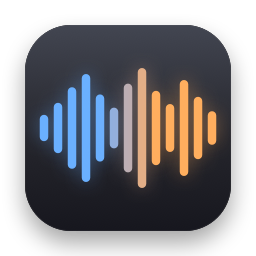
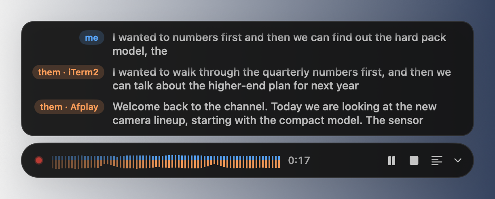
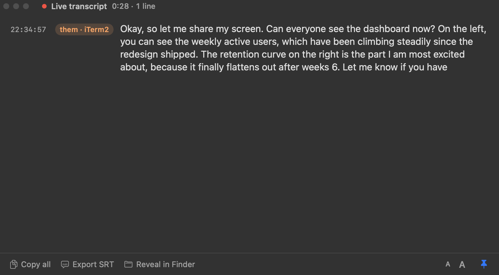
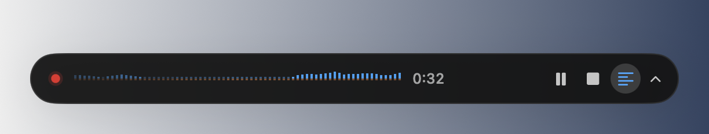

<p align="center">
  
</p>

<h1 align="center">hearsay</h1>

<p align="center">
  <b>Live, offline transcripts of your calls.</b><br>
  Who said what, you or them, as it happens, from the menu bar.<br>
  Everything runs on your Mac. Nothing is uploaded.
</p>

<p align="center">
  <a href="https://github.com/Larry8668/hearsay/releases/latest"></a>
  
  
  <a href="#install"></a>
  
</p>

<p align="center">
  
</p>

## What it does

Press **⌃⌥H** at the start of a call. hearsay listens to your microphone (**me**) and to whatever
your Mac is playing (**them**: Zoom, Meet, Teams, FaceTime, a video), turns both into text on the
Neural Engine, and saves a Markdown transcript when you stop.

- **Me and them, kept apart.** Two audio paths, two colours. The app the other side came from is
  on every line: *them · Zoom*.
- **Several apps at once.** A call in one app and a video in another are transcribed separately,
  each with its own label, never blended.
- **Live captions** on a small bar at the bottom of the screen: the last two lines per speaker,
  scrolling up like subtitles. The full text is one click away.
- **Who said what.** Several people on one microphone, or on one call, are told apart as they
  talk: *Speaker 1*, *Speaker 2*, *them · Zoom · Speaker 2*, each in its own shade, until you
  give them names. Teach it your voice once and you stay *me*.
- **Your transcripts, kept.** Every call in one window: title it, tag it, name the speakers
  ("them · Zoom" → "Priya"), search across all of them, and export what you choose to show as
  Markdown, JSON, plain text or subtitles.
- **Speakers or headphones.** With speakers, echo cancellation and a text-level echo filter keep
  the other side out of your lane.
- **Offline, private.** The speech model (about 580 MB) and the speaker model (234 MB) are
  downloaded once, when you choose them, and run locally. The
  only network request hearsay ever makes is an optional daily check for a new version.
- **Light.** About 8% of one core while listening with headphones, 1% when idle.

<p align="center">
  
</p>

## Install

Requires macOS 14.2 or later on Apple Silicon.

```sh
brew tap Larry8668/hearsay
brew trust Larry8668/hearsay       # Homebrew 7+: third-party taps must be trusted
brew install --cask hearsay
```

Or download the zip from the [releases page](https://github.com/Larry8668/hearsay/releases), move
`hearsay.app` to Applications and right-click → Open the first time (it is signed but not
notarised). To build it yourself, see [Building from source](docs/BUILDING.md).

## Getting started

1. **Open hearsay.** Choose which models to download (the speech model, about 580 MB or a
   smaller 214 MB one; optionally a speaker model, 43 to 234 MB), then allow **Microphone** access.
2. **Start listening** with ⌃⌥H or from the menu-bar waveform. The first time, macOS asks for
   **System Audio Recording**.
3. **Talk.** The bar at the bottom shows live captions; its list button opens the hearsay
   window with the full live transcript, speaker toggles and every past transcript. ⌃⌥P pauses.
4. **Stop** with ⌃⌥H. The transcript is in `~/Documents/hearsay`, as Markdown and JSON; give it
   a title and tags in the window, and export it (⌘E) as Markdown, JSON, text or subtitles.

<p align="center">
  
</p>

## Transcript

```markdown
# Call transcript — Tue 10 Nov 2026, 10:03–10:41 (38 min)
_Apps heard: Zoom · Engine: parakeet-unified-640ms · Made with hearsay, on this Mac._

**10:03:12 them (Zoom)** Thanks everyone for joining today. I wanted to walk through the quarterly numbers first.

**10:03:20 me** Sounds good. Can you share the dashboard?
```

## Learn more

- [Using hearsay](docs/USING.md): the bar, the main window, echo cancellation, several apps,
  pausing, the menu, privacy.
- [Building from source](docs/BUILDING.md): toolchain, signing identity, dev aids.
- [Performance](docs/PERFORMANCE.md): what it costs and why.
- [Releasing](packaging/RELEASING.md): how a version ships to the Homebrew tap.

## How it works

The microphone comes through `AVAudioEngine`, with Apple's voice processing for echo cancellation
when the output is a loudspeaker. System audio comes through a Core Audio process tap per app
(macOS 14.2+), so each app is its own stream. Both are resampled to 16 kHz and fed to
[FluidAudio](https://github.com/FluidInference/FluidAudio)'s streaming Parakeet model (NVIDIA
Parakeet Unified 0.6B, CoreML, Neural Engine). English today; the engine sits behind a small
protocol so other models can be added.

## Privacy

Audio never leaves the machine and is never written to disk; only text is saved, to
`~/Documents/hearsay`. The daily update check (one request to api.github.com for the latest
release tag) can be turned off in Settings. No analytics, no accounts.

## Credits

Speech recognition by [FluidAudio](https://github.com/FluidInference/FluidAudio) (Apache-2.0)
running NVIDIA's Parakeet models (CC-BY-4.0).
